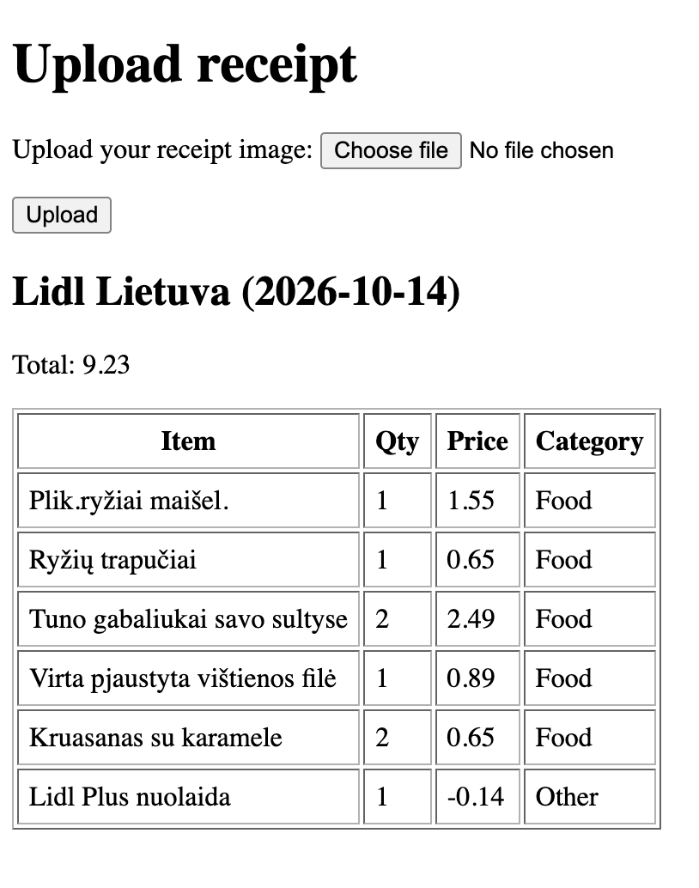
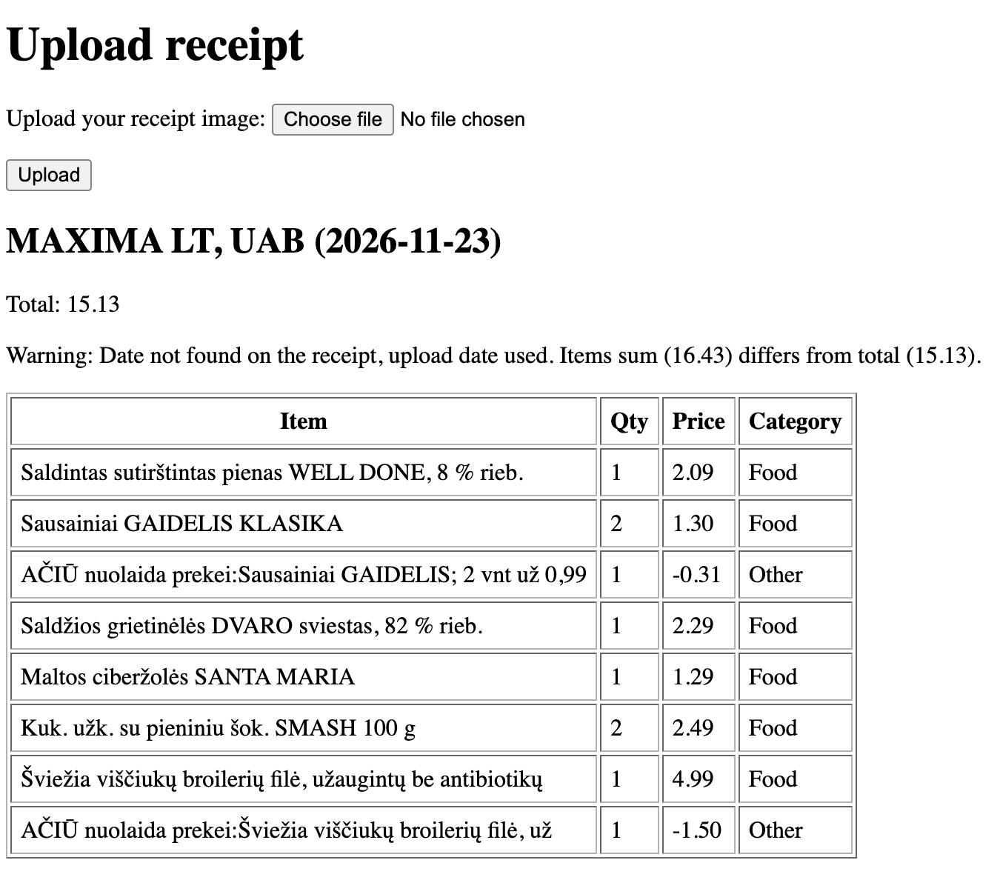
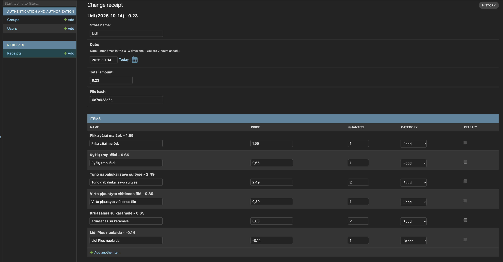

# expense-tracker-ai

A web application built with Python and Django that extracts itemized data from receipt photos, categorizes each item and checks that the items add up to the receipt total. It uses a vision-capable OpenAI model to read the receipts.

## Screenshots

### Receipt extraction (Lidl)


### Missing date and total mismatch warnings (Maxima)


### Editing saved receipt and items in Django Admin


## How It Works
1. **Upload:** The user uploads a receipt photo through the Django web interface.
2. **AI processing:** The image is resized and encoded as base64, then sent to gpt-4o. The system prompt lists the allowed categories and asks for a JSON response. Unknown categories fall back to "Other".
3. **Validation and storage:** Duplicate files are skipped using a file hash, before the API is called. The receipt and its items are saved in one transaction, and a warning is shown if the item sum differs from the receipt total or if the date is missing.
4. **Review:** Results are shown in a table and can be corrected in Django Admin.

## Tech Stack
* **Backend:** Python, Django
* **AI integration:** OpenAI API (gpt-4o, vision)
* **Database:** SQLite (Django ORM)
* **Frontend:** HTML (Bootstrap planned)

## Project Structure

```
expense-tracker-ai/
├── config/                  # Django project settings and root URLs
├── receipts/                # The main app
│   ├── ai.py                # System prompt and the call to the OpenAI model
│   ├── views.py             # Upload handling, duplicate check, validation, saving
│   ├── models.py            # Receipt and Item models
│   ├── forms.py             # Upload form
│   ├── admin.py             # Admin setup (items are edited inline under a receipt)
│   ├── urls.py              # App routes
│   ├── migrations/          # Database migrations
│   └── templates/receipts/
│       └── upload.html      # Upload page and result table
├── manage.py
├── requirements.txt
└── .env.example             # Required environment variables
```

### Data Model
* **Receipt:** store name, date, total amount and a unique file hash (used to skip duplicate uploads).
* **Item:** name, unit price, quantity and category. Each item belongs to one receipt, and deleting a receipt deletes its items.

## Getting Started

```bash
git clone https://github.com/veronikaleleka/expense-tracker-ai.git
cd expense-tracker-ai
python -m venv .venv
source .venv/bin/activate
pip install -r requirements.txt
```

Copy the example environment file and fill in your keys:

```bash
cp .env.example .env
```

You can generate a Django secret key with:

```bash
python -c "from django.core.management.utils import get_random_secret_key; print(get_random_secret_key())"
```

Then run:

```bash
python manage.py migrate
python manage.py createsuperuser
python manage.py runserver
```

Open http://127.0.0.1:8000/ to upload a receipt. Saved receipts can be managed at http://127.0.0.1:8000/admin/. Every upload calls the OpenAI API and costs a small amount.

## Prompt Iterations
Real receipts exposed problems that a single prompt did not solve:

* **Lithuanian characters** were replaced with plain letters. Fixed by instructing the model to keep them, sending the image in higher detail and switching from gpt-4o-mini to gpt-4o, which read the small diacritics more reliably (at a higher cost per receipt).
* **Discount lines** came with the wrong sign, or a summary line ("total savings") was added as an extra item. Fixed by telling the model to keep printed signs and to skip lines that only repeat discounts already listed.
* **Invented dates:** when the date was not visible in the photo, the model made one up. The prompt now allows `null`, and the app falls back to the upload date with a warning.

The sum check (items vs. total) exposed the discount problems: whenever a discount line was missing, duplicated or had the wrong sign, the totals no longer matched and a warning appeared. The other two problems were found by reading the results.

## Limitations
* Small or blurry text can still be misread, for example Lithuanian letters in discount line names.
* Results can occasionally differ between runs for the same receipt.
* Duplicates are detected by file hash, so two different photos of the same receipt are treated as separate receipts.
* Extracted data cannot be edited before saving. Corrections are made afterwards in Django Admin.

## Roadmap
* [ ] Review and edit extracted data before saving.
* [ ] Style the UI with Bootstrap.
* [ ] Add user authentication (login/register).
* [ ] Monthly expense analytics and charts.
* [ ] Export data to CSV/Excel.
